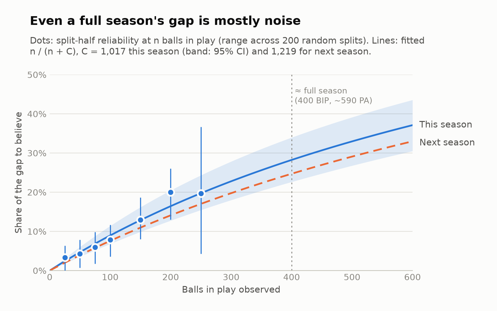
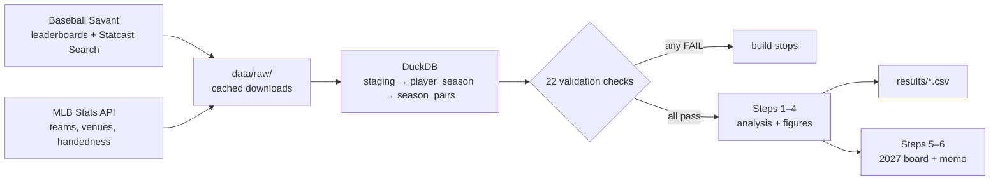

# How Much Should a Front Office Trust a Hitter's xwOBA Gap?

**When a hitter's results beat the quality of his contact, is that skill or luck, and how much should a team pay for it?**
I answered it with every MLB plate appearance from 2021–2026, a validated SQL pipeline, and out-of-sample forecast tests.

| | |
|---|---|
| **Short answer** | Price hitters on **xwOBA** and ignore the gap. It adds nothing to next-season forecasts, even with three seasons of history. |
| **Front-office takeaway** | Arozarena's 2026 line overstates him by ~50 points. Seven of eight Mets regulars project above their 2026 numbers. → [**Read the 1-page memo**](docs/memo.md) |
| **Data** | 2,774 player-seasons (2021–26) + 2,216 (2015–19), Baseball Savant + MLB Stats API, reconciled to 0 PA mismatches |
| **Built with** | Python · SQL (DuckDB) · pytest · bootstrapped confidence intervals |
| **Status** | ✅ Complete (Oct 2026) |

<picture>
  <source media="(prefers-color-scheme: dark)" srcset="docs/figures/step2_trust_dark.png">
  
</picture>

*How much of a hitter's gap to believe, by sample size. Even a full season (~400 balls in play) is only about a quarter signal.*

---

## Key terms (10 seconds)

- **wOBA:** what a hitter actually produced (hits, walks, home runs, each weighted by its value).
- **xwOBA:** what he *should* have produced, given how hard and at what angle he hit the ball.
- **The gap:** wOBA − xwOBA. A .350 wOBA with a .320 xwOBA is a +30 gap.

## Five findings

| # | Finding | The number | Details |
|---|---|---|---|
| 1 | **To project next season, use xwOBA and ignore the gap.** | Adding the gap changes forecast error by +0.01 points (95% CI −0.04 to +0.06) | [Step 4](docs/step4.md) |
| 2 | **Even a full season's gap is mostly luck.** | ~25% carries into next season; half signal only after ~1,000 balls in play (≈2.5 seasons) | [Step 2](docs/step2.md) |
| 3 | **The part that repeats is mostly pulled power.** | A pulled 100–105 mph fly ball beats xwOBA by **+502** points; the same ball to center/opposite field falls **270** short | [Step 3](docs/step3.md) |
| 4 | **The gap repeats less than published research says.** | Year-over-year r = **.38** (2015–19) → **.25** (2021–26); published result reproduced first (r = .42 vs. .43) | [Step 1](docs/step1.md) |
| 5 | **Three seasons plus age beat one season, and the gap still doesn't help.** | Forecast error falls **0.86 points** (95% CI 0.28–1.45); adding a 3-season gap: −0.02 (CI −0.09 to +0.05) | [Step 6](docs/step6.md) |

**The projection the memo uses:** three seasons of xwOBA weighted 5/4/3, shrunk toward league by playing time, plus an aging curve (peak 27). Typical miss ±28 points. [Details](docs/step6.md)

## Where to go next

| You have... | Read |
|---|---|
| **2 minutes** | [The front-office memo](docs/memo.md): free agents, Mets hitters, buy-low trade targets |
| **10 minutes** | The step write-ups, each opening with a one-paragraph answer: [1](docs/step1.md) · [2](docs/step2.md) · [3](docs/step3.md) · [4](docs/step4.md) · [6](docs/step6.md) |
| **An interest in the data engineering** | [How the pipeline works](#how-the-pipeline-works) · [validation report](docs/validation_report.md) · [data notes](docs/data_notes.md) · [data dictionary](docs/data_dictionary.md) |
| **A laptop** | [Reproduce it](#reproduce-it) |

---

## How the pipeline works



**Validation is the backbone.** Every build runs 22 SQL checks ([`sql/02_validation.sql`](sql/02_validation.sql)): uniqueness at every join stage, all seasons present, missing values, plausible ranges, PA reconciliation between Savant and the MLB Stats API, and a cross-check of every player-season's PA, wOBA, and xwOBA against a second Savant endpoint (**2,774 of 2,774 match**; 2,216 of 2,216 for 2015–19).

**One check caught a real bug:** the MLB Stats API's team endpoint leaves out players who changed teams midseason. That undercounted PA for 31 hitters and could have assigned them the wrong home park. Fixed and documented in [`docs/data_notes.md`](docs/data_notes.md).

<details>
<summary><b>Data sources</b> (click to expand)</summary>

All public. Downloaded by `src/fetch_data.py` and cached in `data/raw/`. The raw files are **not committed**: MLB Advanced Media's terms limit this data to personal, non-commercial use, so the repo ships the code to rebuild it instead.

| Source | Fields | Notes |
|---|---|---|
| [Baseball Savant](https://baseballsavant.mlb.com) custom leaderboard | PA, wOBA, xwOBA, K%, BB%, barrel %, hard-hit %, spray %, batted-ball type %, sprint speed, bat speed | Min 100 PA, 2021–2026. Bat speed: full seasons from 2024 |
| Savant batted-ball leaderboard | Pulled / straightaway / opposite-field air-ball rates | Min 50 batted balls |
| Savant expected-stats leaderboard | PA, wOBA, xwOBA | Independent endpoint, used only to cross-check |
| [MLB Stats API](https://statsapi.mlb.com) | PA by team, team and venue IDs, batting hand | Joined on MLBAM player ID |
| Savant, 2015–2019 | PA, AB, pitches, wOBA, xwOBA, sprint speed | Era comparison and replication (step 1) |
| Savant Statcast Search | Every 2021–2026 plate appearance: result, batted-ball type, exit velocity, launch angle, hit coordinates, expected wOBA | Steps 2–3; reconciled to the leaderboards (0 PA mismatches across 2,774 player-seasons) |

**Dataset:** 2,774 player-seasons and 1,780 consecutive-season pairs (2021–2026), plus 2,216 player-seasons and 1,365 pairs (2015–2019). Column definitions: [`docs/data_dictionary.md`](docs/data_dictionary.md).

</details>

<details>
<summary><b>Why this question, and what's new here</b> (click to expand)</summary>

How much of the gap regresses is usually stated as a rule of thumb rather than measured. The published evidence: when the same hitters are tracked across consecutive seasons, the gap's year-over-year R² is about .17 (r ≈ .43 in Melchior's 2015–2019 sample), so well under half of it carries forward ([Edwards, FanGraphs 2017](https://blogs.fangraphs.com/how-to-beat-statcasts-hitting-metric); [Melchior, RotoGraphs 2019](https://fantasy.fangraphs.com/are-there-chronic-woba-over-and-under-performers)).

Prior work also identified where the repeatable part comes from:
- **Sprint speed**, which drove much of the gap ([Chamberlain 2018](https://fantasy.fangraphs.com/how-sprint-speed-relates-to-woba-xwoba)) and which xwOBA has partly accounted for since 2019, on topped and weakly hit balls ([MLB glossary](https://www.mlb.com/glossary/statcast/expected-woba)).
- **Pulled, hard-hit fly balls**, a sticky hitter trait that xwOBA doesn't capture because it doesn't use spray angle ([Clemens, FanGraphs 2023](https://blogs.fangraphs.com/an-meandering-examination-of-fly-ball-pull-rate-featuring-stars-of-the-game-and-also-isaac-paredes/); [Salorio 2024](https://adamsalorio.substack.com/p/introducing-opt_95-identifying-hitters)). In 2019 Tom Tango found xwOBA showed no bias by a hitter's overall pull tendency and left spray angle for future work ([tangotiger.com](https://tangotiger.com/index.php/site/comments/of-spray-angles-fip-and-xwoba-part-2)); later work points to the hard-hit, pulled fly ball specifically.
- **Park**, which xwOBA removes by design.

What this project adds:
1. **A replication on 2021–2026 data.** Earlier estimates use 2015–2019 data, mostly from before xwOBA added sprint speed (2019) and all from before the 2023 shift ban.
2. **Reliability as a function of sample size.** I haven't found a published curve for the gap on post-2022 data: how much of a 150-batted-ball gap vs. a 450-batted-ball gap should carry forward?
3. **An out-of-sample test.** Does adjusting for pulled fly balls and park predict *next season's* wOBA better than xwOBA alone? (It doesn't.)

| Step | Question | Write-up |
|---|---|---|
| 0 | Build a reproducible, validated player-season dataset (2021–2026) | [Validation report](docs/validation_report.md) |
| 1 | How strongly does the gap persist year over year, and does it match the published r ≈ .43? | [Step 1](docs/step1.md) |
| 2 | How does gap reliability change with sample size? | [Step 2](docs/step2.md) |
| 3 | Which hitter traits (pulled-air rate, park, speed, handedness) explain the persistent part? | [Step 3](docs/step3.md) |
| 4 | Does an adjusted expectation beat plain xwOBA at predicting next-season wOBA? | [Step 4](docs/step4.md) |
| 5 | Which 2026 hitters' results misstate their underlying quality? | [Memo](docs/memo.md) |
| 6 | Do three seasons and age improve the projection, and does the gap help then? | [Step 6](docs/step6.md) |

</details>

<details>
<summary><b>Limitations</b> (click to expand)</summary>

- Projections are **offense only**, with a simple two-slope **age curve** (peak 27) rather than position-specific aging. They rank hitters by what contact quality and track record support; they aren't full player valuations.
- 2027's league offensive level is unknown; projections are relative to 2026's.
- Contract status in the memo comes from public reporting (MLB.com, August 2026), not team records.

</details>

## Reproduce it

```bash
pip install -r requirements.txt
python src/fetch_data.py          # download raw data (~2 min; skips cached files, --force to refresh)
python src/build_db.py            # build data/statcast.duckdb and run the 22 checks (exits non-zero on a FAIL)
pytest                            # same checks as a test suite
python src/fetch_statcast.py      # every 2021-26 plate appearance (~35 min, ~24 MB)
```

<details>
<summary><b>Run each analysis step</b> (click to expand)</summary>

```bash
python src/step1_persistence.py   # step 1 -> results/step1_*.csv
python src/step1_figures.py       # step 1 charts -> docs/figures/
python src/step2_reliability.py   # step 2 (~20 min, mostly bootstrap) -> results/step2_*.csv
python src/step3_traits.py        # step 3 -> results/step3_*.csv
python src/step23_figures.py      # step 2-3 charts
python src/step4_projection.py    # step 4 -> results/step4_*.csv
python src/step5_board.py         # step 5: one-season 2027 projections -> results/step5_board.csv
python src/step6_multiseason.py   # step 6: 3-season + age test and board -> results/step6_*.csv
```

</details>

<details>
<summary><b>Repository layout</b> (click to expand)</summary>

```
src/fetch_data.py         download Savant + MLB Stats API data to data/raw/
src/build_db.py           build the DuckDB database, run checks, write the report
src/fetch_statcast.py     plate-appearance-level Statcast download
src/step*_*.py            analysis and figures for each step
sql/01_build_tables.sql   staging tables, player_season, season_pairs, 2015-19 history
sql/02_validation.sql     data-quality checks
sql/03_step1_pairs.sql    step 1 analysis table (centered and speed-adjusted gaps)
sql/04*_statcast_*.sql    plate-appearance tables valued with each season's exact weights
sql/05_step3_traits.sql   spray angle, park effects, forecast-safe park exposure
tests/                    pytest wrapper around the validation checks
results/                  step outputs (CSV)
docs/                     memo, step write-ups, figures, data dictionary, validation report, data notes
```

</details>

## About

Built by **Jack Eisinger** ([LinkedIn](https://www.linkedin.com/in/jack-eisinger)). I played baseball through high school and am a lifelong Mets fan. Before this, I spent a year at Epic validating clinical data with SQL and translating physicians' questions into testable requirements. The reliability framing in step 2 comes from my psychology research background (survey design, Cronbach's alpha).

Code was written with [Claude Code](https://claude.com/claude-code) under my direction. I chose the question, reviewed every data decision, and can walk through any line.
